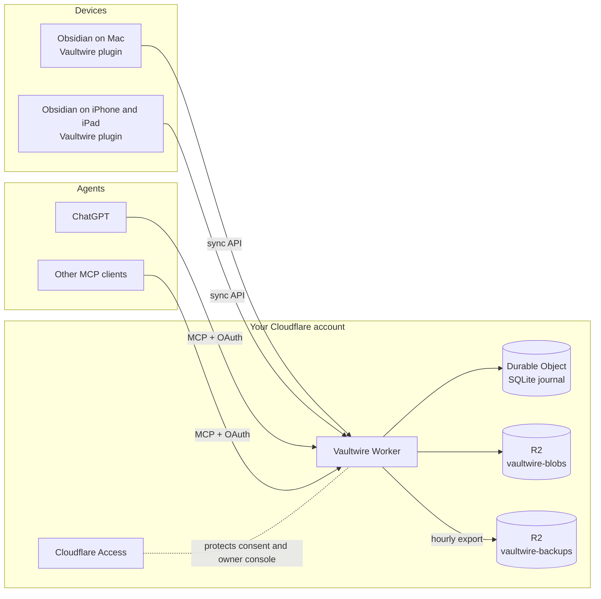

<div align="center">


# Vaultwire

**Self-hosted vault sync and storage, with MCP tools for AI agents.**

Keep one Obsidian vault in step across your devices, on your own Cloudflare account.<br>
Let ChatGPT or any MCP client read, search and edit your notes with your consent.

[](https://github.com/moisesmorillo/vaultwire/actions/workflows/check.yml)
[](https://github.com/moisesmorillo/vaultwire/releases)
[](https://github.com/moisesmorillo/vaultwire/releases)
[](LICENSE)
[](https://workers.cloudflare.com/)
[](https://obsidian.md/)


</div>

## Why Vaultwire

- **Your data, your account.** Notes live in a Durable Object SQLite journal and R2 buckets that you own. No third-party sync service sees your vault.
- **Safe sync by design.** Every change is conditional on the exact revision the device saw. A deletion never happens because a file is absent. A stale revision never overwrites a newer one. A conflict always leaves two visible files.
- **AI agents with consent.** ChatGPT and other MCP clients connect through OAuth. You approve each client on a consent page behind Cloudflare Access, and you can revoke it at any time.
- **Hourly backups.** The Worker writes a packed export of the vault every hour and keeps it for 15 days.
- **An owner console.** One protected page shows clients, grants, measurements, backups and blob cleanup.

## How it works



The Worker is the single authority for the vault. Each device keeps a local journal and a cursor into the server change feed. A device publishes local edits as conditional operations. It applies a remote change only when the local file still matches what it last saw. Attachments go to R2 as immutable, content-addressed blobs.

## MCP tools

Connect any MCP client to `https://<your-host>/mcp`. The client registers itself, then you approve it on the consent page.

| Tool | What it does |
| --- | --- |
| `list_notes` | List notes and folders in the vault |
| `search_notes` | Search note text |
| `read_note` | Read one note at its current revision |
| `get_history` | Show earlier revisions of a note |
| `create_note` | Create a new note |
| `update_note` | Replace a note when its revision still matches |
| `append_to_note` | Add text to the end of a note |
| `append_under_heading` | Add text under a heading |
| `delete_note` | Delete a note when its revision still matches |

Write tools follow the same revision rules as the plugin. An agent cannot overwrite an edit it has not seen.

### Use it from ChatGPT

1. In ChatGPT, open the plugin settings and choose **Add custom MCP server**.
2. Name it `Vaultwire`, upload [`docs/assets/vaultwire-icon.png`](docs/assets/vaultwire-icon.png) as the icon, and enter `https://<your-host>/mcp` with OAuth.
3. Approve the consent page and name the client `ChatGPT`.
4. Ask things like *"Vaultwire, list the folders in my vault"* or *"Add today's meeting notes to Work/Meetings"*.

## Screenshots

<table>
  <tr>
    <td width="50%"></td>
    <td width="50%"></td>
  </tr>
  <tr>
    <td align="center"><b>Measurements</b><br/>Requests, feed latency, storage and read slots</td>
    <td align="center"><b>Backups</b><br/>Hourly packed exports with 15-day retention</td>
  </tr>
  <tr>
    <td width="50%"></td>
    <td width="50%"></td>
  </tr>
  <tr>
    <td align="center"><b>Consent</b><br/>Approve each device or agent once</td>
    <td align="center"><b>Clients</b><br/>Rename or revoke any client</td>
  </tr>
</table>

Screenshots use synthetic demo data.

## Install the plugin

Vaultwire is not in the Obsidian community catalog yet. Install it with [BRAT](https://github.com/TfTHacker/obsidian42-brat):

1. Install and enable **BRAT** from the community plugins.
2. In BRAT, choose **Add beta plugin** and enter `moisesmorillo/vaultwire`.
3. Enable **Vaultwire**, open its settings, enter your service address and click **Connect**.
4. Approve the device in the browser, then click **Resume**.

Moving a device from the old AI Bridge plugin? Follow [`apps/plugin/tools/plugin-id-migration.md`](apps/plugin/tools/plugin-id-migration.md).

## Run your own

You need a Cloudflare account with a zone, Workers, R2 and Zero Trust Access.

1. Create two R2 buckets, one KV namespace for OAuth and a Workers custom domain. Protect `/authorize` and `/owner/*` with an Access application.
2. Set the names, the Access audience and your owner subject in [`apps/worker/wrangler.production.jsonc`](apps/worker/wrangler.production.jsonc).
3. Deploy with the [`deploy.yml`](.github/workflows/deploy.yml) workflow or `wrangler deploy --config wrangler.production.jsonc`.
4. Open `https://<your-host>/owner/clients` to see the console.

The reference deployment manages every Cloudflare resource with OpenTofu in a separate infrastructure repository.

## Development

```sh
mise trust && mise install
mise exec -- bun install --frozen-lockfile
mise exec -- bun run check
```

`bun run check` runs Biome, TypeScript, the documentation gate, every Vitest suite and the package builds. It never deploys.

| Workspace | Role |
| --- | --- |
| [`apps/worker`](apps/worker) | Cloudflare Worker: sync API, MCP, OAuth, owner console, backups |
| [`apps/plugin`](apps/plugin) | Obsidian plugin: local journal, publish and apply, conflict copies |
| [`packages/protocol`](packages/protocol) | Zod schemas and codecs shared by Worker and plugin |
| [`tooling`](tooling) | Release, documentation and deployment checks |

Releases are automatic. [Release Please](.github/workflows/release-please.yml) opens one release PR per component. Merging the plugin release publishes `main.js` and `manifest.json` for BRAT. Merging the Worker release deploys the Worker.

## Project records

- [`docs/spec.md`](docs/spec.md) is the product contract.
- [`docs/api`](docs/api) documents the HTTP, measurement and blob cleanup interfaces.
- [`backlog/`](backlog) tracks work in progress, done and deferred, through the Backlog.md CLI.
- [`AGENTS.md`](AGENTS.md) holds the rules for contributors and coding agents.

## License

[MIT](LICENSE) © Moisés Morillo
