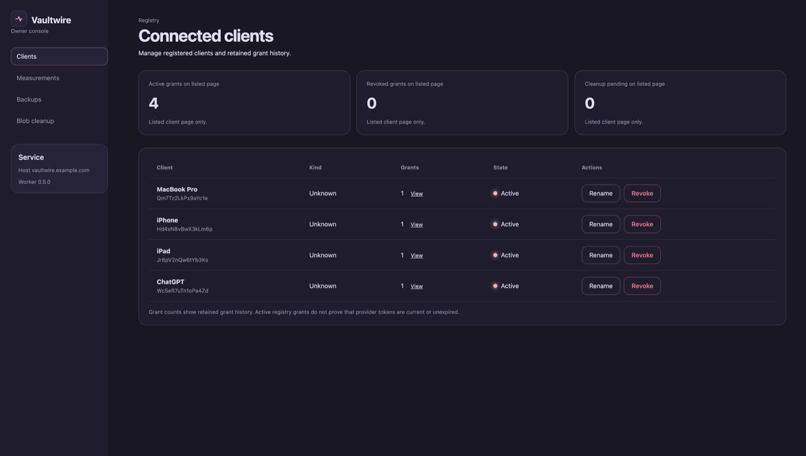
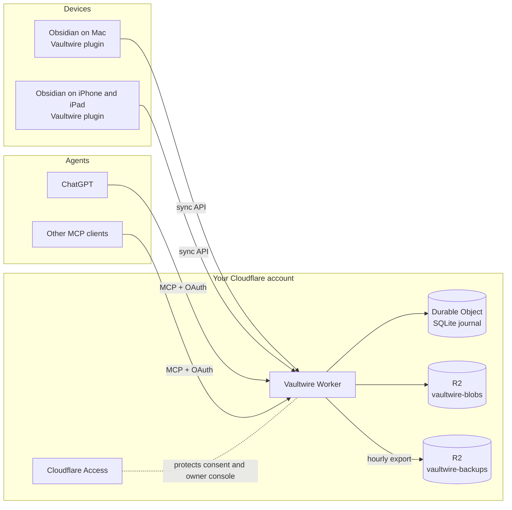
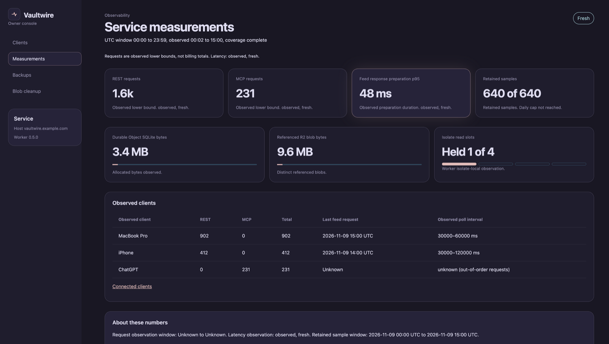
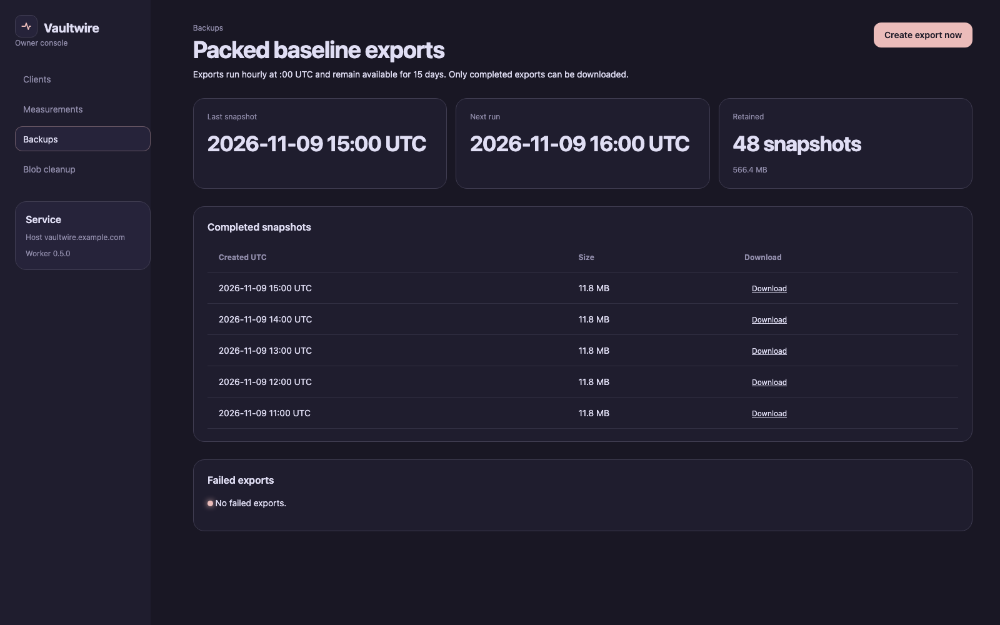
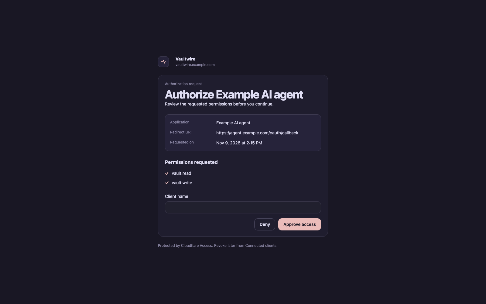

<div align="center">


# Vaultwire

**Self-hosted vault sync and storage, with MCP tools for AI agents.**

Keep one Obsidian vault in step across your devices, on your own Cloudflare account.<br>
Let ChatGPT or any MCP client read, search and edit your notes with your consent.

[](https://github.com/moisesmorillo/vaultwire/actions/workflows/check.yml)
[](https://github.com/moisesmorillo/vaultwire/releases)
[](https://github.com/moisesmorillo/vaultwire/releases)
[](LICENSE)
[](https://workers.cloudflare.com/)
[](https://obsidian.md/)



</div>

## Why Vaultwire

- **Your data, your account.** Notes live in a Durable Object SQLite journal and R2 buckets that you own. No third-party sync service sees your vault.
- **Safe sync by design.** Every change is conditional on the exact revision the device saw. A deletion never happens because a file is absent. A stale revision never overwrites a newer one. A conflict always leaves two visible files.
- **AI agents with consent.** ChatGPT and other MCP clients connect through OAuth. You approve each client on a consent page behind Cloudflare Access, and you can revoke it at any time.
- **Hourly backups.** The Worker writes a packed export of the vault every hour and keeps it for 15 days.
- **An owner console.** One protected page shows clients, grants, measurements, backups and blob cleanup.

## How it works



The Worker is the single authority for the vault. Each device keeps a local journal and a cursor into the server change feed. A device publishes local edits as conditional operations. It applies a remote change only when the local file still matches what it last saw. Attachments go to R2 as immutable, content-addressed blobs.

## MCP tools

Connect any MCP client to `https://<your-host>/mcp`. The client registers itself, then you approve it on the consent page.

| Tool | What it does |
| --- | --- |
| `list_notes` | List notes and folders in the vault |
| `search_notes` | Search note text |
| `read_note` | Read one note at its current revision |
| `get_history` | Show earlier revisions of a note |
| `create_note` | Create a new note |
| `update_note` | Replace a note when its revision still matches |
| `append_to_note` | Add text to the end of a note |
| `append_under_heading` | Add text under a heading |
| `delete_note` | Delete a note when its revision still matches |

Write tools follow the same revision rules as the plugin. An agent cannot overwrite an edit it has not seen.

### Connect ChatGPT

These form values match an owner setup on ChatGPT web on 2026-11-09. ChatGPT labels and menus can change.

In ChatGPT plugin or connector settings, add a custom MCP server and create it as a plugin. Use these values:

| Field | Value |
| --- | --- |
| Icon | [`docs/assets/vaultwire-icon.png`](docs/assets/vaultwire-icon.png) |
| Name | `Vaultwire` |
| Description | `Read, search and edit my Obsidian vault notes` |
| Server URL | `https://<your-host>/mcp` |
| Authentication | OAuth |
| Advanced OAuth settings | Leave empty. The server publishes OAuth metadata. |

ChatGPT opens the Vaultwire consent page behind Cloudflare Access. Sign in through Access, approve the request, and name the client `ChatGPT`. A custom MCP plugin on a personal account is visible only to that account. Vault access also needs Access login and consent.

Do not configure keywords. ChatGPT selects tools from their names, descriptions, and the server instructions sent at initialization. Mention “my vault” or “Vaultwire” in a prompt, or enable Vaultwire in the message tool picker. You can add this custom instruction:

> When I talk about my notes, my vault or Obsidian, use Vaultwire to search, read or create them.

Try these prompts:

- “Vaultwire, find my notes about the last planning meeting.”
- “Read my note about the release checklist and summarize the open items.”
- “Create separate notes for these three project ideas in `Ideas/`.”

### Connect other MCP clients

Vaultwire uses Streamable HTTP at `https://<your-host>/mcp`. It supports OAuth, authorization discovery, and dynamic client registration. Each client needs its own consent.

#### Claude Code

Add Vaultwire with the [Claude Code MCP command](https://code.claude.com/docs/en/mcp):

```sh
claude mcp add --transport http vaultwire https://<your-host>/mcp
```

Then run `/mcp` in Claude Code to authenticate. Sign in through Cloudflare Access and approve the Vaultwire consent request.

#### Claude custom connectors

Claude supports remote custom connectors with OAuth. Follow the [Claude custom connector guide](https://support.claude.com/en/articles/11175166-getting-started-with-custom-connectors-using-remote-mcp) to add `https://<your-host>/mcp`. Sign in through Access and approve the consent request. Connector controls can change, so use the current Claude guide rather than these menu labels.

#### Other Streamable HTTP clients

In a client that supports Streamable HTTP and OAuth discovery, add `https://<your-host>/mcp` as its remote server. Follow that client's current setup guide, then sign in through Access and approve its consent request.

The server sends these instructions to MCP clients:

> Use Agents/ for agent notes and Agents/Log/YYYY-MM-DD.md for daily logs. New notes need frontmatter with created and source fields. Search before you create a note. Pass the exact ETag from read_note to update_note and append_under_heading. Always generate a fresh idempotency key for each append. Reuse that key only to retry the same append with the same text. Receipts last 30 days. A retry after receipt expiry can append the text again.

For `update_note` and `append_under_heading`, pass the `etag` argument from `read_note`. For append tools, use the `idempotency_key` argument. Make a fresh key for each append, and reuse it only to retry the same text. Each client needs separate consent. To revoke a client, open the Access-protected [`/owner/clients`](https://<your-host>/owner/clients) page.

## Screenshots

<table>
  <tr>
    <td width="50%"></td>
    <td width="50%"></td>
  </tr>
  <tr>
    <td align="center"><b>Measurements</b><br/>Requests, feed latency, storage and read slots</td>
    <td align="center"><b>Backups</b><br/>Hourly packed exports with 15-day retention</td>
  </tr>
  <tr>
    <td width="50%"></td>
    <td width="50%"></td>
  </tr>
  <tr>
    <td align="center"><b>Consent</b><br/>Approve each device or agent once</td>
    <td align="center"><b>Clients</b><br/>Rename or revoke any client</td>
  </tr>
</table>

Screenshots use synthetic demo data.

## Install the plugin

Vaultwire is not in the Obsidian community catalog yet. Install it with [BRAT](https://github.com/TfTHacker/obsidian42-brat):

1. Install and enable **BRAT** from the community plugins.
2. In BRAT, choose **Add beta plugin** and enter `moisesmorillo/vaultwire`.
3. Enable **Vaultwire**, open its settings, enter your service address and click **Connect**.
4. Approve the device in the browser. Then click **Resume** to start sync.

Moving a device from the old AI Bridge plugin? Follow [`apps/plugin/tools/plugin-id-migration.md`](apps/plugin/tools/plugin-id-migration.md).

## First sync and moving an existing vault

On the first device, Connect authorizes the plugin. After you approve the device and click **Resume**, sync starts. If the service has no files, Vaultwire imports supported local files into the service. Unsupported paths stay out of sync.

For each new device, start with an empty local vault and let Vaultwire hydrate it from the service. This avoids mixing old local files with the existing server vault. If the device already has files, Vaultwire compares file hashes: equal files need no copy, local-only files upload, and remote-only files download. If both sides have different content, Vaultwire keeps the local version as a conflict copy and applies the remote version at its path.

### Coexistence with another sync tool

Use coexistence mode while another tool still syncs the same live vault. The mode queues local deletes and renames for your confirmation. It does not make two sync tools safe to use on one live vault.

Placeholder handling is specific to iCloud: Vaultwire excludes `*.icloud` placeholders and treats a placeholder as unavailable, not as a delete. This iCloud behavior does not describe other providers. For any provider, avoid concurrent writes to the same file. Text apply checks the file hash during the write. Binary apply has a best-effort race window, so a concurrent write can still conflict.

**Pause** stops publishing and applying but keeps queued work. **Resume** continues with those queues. To exit coexistence, empty its confirmation queue, then disable the plugin or turn coexistence off. Before cutover, make a dated local backup and stop the other sync tool. Keep one sync owner per device. Reconnect other devices with fresh local vaults. Never let two sync tools write the same live vault after cutover.

See [`docs/packed-export-restore.md`](docs/packed-export-restore.md) to verify a packed backup and restore current files into a new local vault. It does not restore the service vault. See [`docs/f4-coexistence-trial.md`](docs/f4-coexistence-trial.md) for the iCloud-specific F4 trial procedure.

## Run your own

You need a Cloudflare account with a zone, Workers, R2 and Zero Trust Access.

1. Create two R2 buckets, one KV namespace for OAuth and a Workers custom domain. Protect `/authorize` and `/owner/*` with an Access application.
2. Set the names, the Access audience and your owner subject in [`apps/worker/wrangler.production.jsonc`](apps/worker/wrangler.production.jsonc).
3. Deploy with the [`deploy.yml`](.github/workflows/deploy.yml) workflow or `wrangler deploy --config wrangler.production.jsonc`.
4. Open `https://<your-host>/owner/clients` to see the console.

The reference deployment manages every Cloudflare resource with OpenTofu in a separate infrastructure repository.

## Development

```sh
mise trust && mise install
mise exec -- bun install --frozen-lockfile
mise exec -- bun run check
```

`bun run check` runs Biome, TypeScript, the documentation gate, every Vitest suite and the package builds. It never deploys.

| Workspace | Role |
| --- | --- |
| [`apps/worker`](apps/worker) | Cloudflare Worker: sync API, MCP, OAuth, owner console, backups |
| [`apps/plugin`](apps/plugin) | Obsidian plugin: local journal, publish and apply, conflict copies |
| [`packages/protocol`](packages/protocol) | Zod schemas and codecs shared by Worker and plugin |
| [`tooling`](tooling) | Release, documentation and deployment checks |

Releases are automatic. [Release Please](.github/workflows/release-please.yml) opens one release PR per component. Merging the plugin release publishes `main.js` and `manifest.json` for BRAT. Merging the Worker release deploys the Worker.

## Project records

- [`docs/spec.md`](docs/spec.md) is the product contract.
- [`docs/api`](docs/api) documents the HTTP, measurement and blob cleanup interfaces.
- [`backlog/`](backlog) tracks work in progress, done and deferred, through the Backlog.md CLI.
- [`AGENTS.md`](AGENTS.md) holds the rules for contributors and coding agents.

## License

[MIT](LICENSE) © Moisés Morillo
